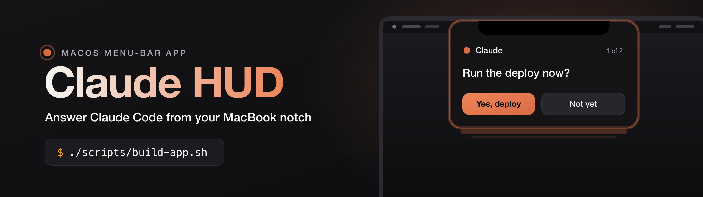
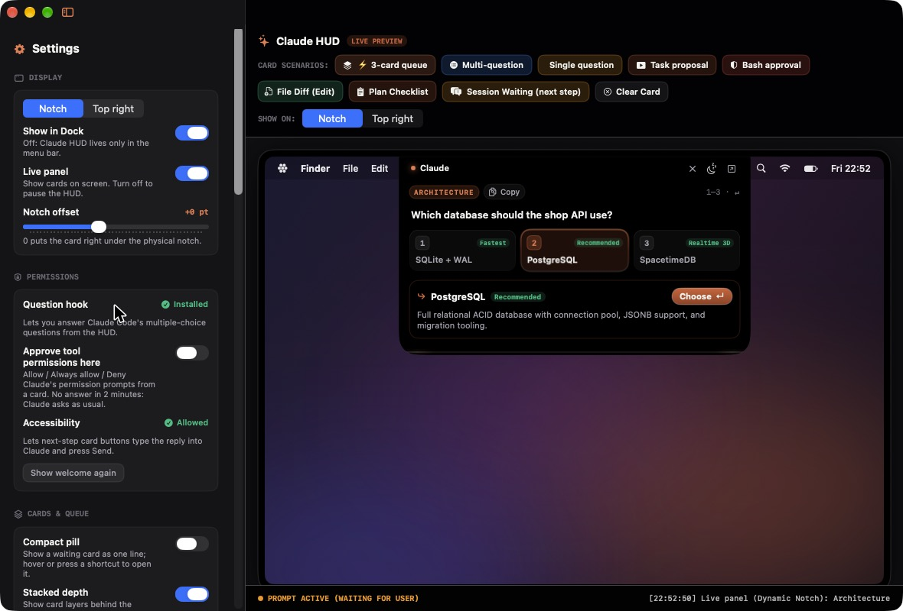

<p align="center">
  
</p>

<p align="center">
  
  
  
  
  <a href="AGENTS.md"></a>
  
</p>

<p align="center">
  <code>claude-code</code> <code>macos</code> <code>notch</code> <code>dynamic-island</code> <code>menu-bar-app</code>
  <code>swiftui</code> <code>ai-agent</code> <code>developer-tools</code> <code>claude-code-hooks</code>
</p>

**Claude HUD is a free, open-source macOS menu-bar app that shows Claude Code's questions and permission prompts in the MacBook notch, so you can answer them without switching windows.**

When a Claude Code session stops to ask you something — a multiple-choice question, "Allow this command?", or the next-step box of the Claude desktop app — a card drops out of the notch (or floats at the top right). Pick an answer with a click or a shortcut and keep working.

<p align="center">
  
</p>

> Claude HUD is an independent project. It is not made, endorsed or supported by Anthropic. "Claude" is a trademark of Anthropic, PBC; the name here only says which tool the app works with.

## What it does

| Card | Comes from | Your answer goes back through |
|---|---|---|
| Multiple-choice question (single or several in a row) | Claude Code's `AskUserQuestion` tool | a `PreToolUse` hook — Claude receives the answers directly |
| Permission prompt: **Allow / Always allow / Deny** | Claude Code's `PermissionRequest` hook (opt-in) | the same hook; "Always allow" adds the rule Claude itself suggested |
| "Next step" question of a Claude desktop session | the session transcript in `~/.claude/projects` | typed into that session's reply box and sent, like you would (needs Accessibility) |

No answer within two minutes? The card steps aside and Claude asks in its own window as usual. Nothing is ever answered without your click or key press.

## Features

- **Notch or top-right** placement, with a live preview on a drawn MacBook screen in the settings window.
- **Queue with depth**: one layer per waiting card under the current one and an "N more" counter.
- **Global shortcuts** while a card is on screen — no Accessibility needed:
  `⌃⌥1…9` pick · `⌃⌥↵` choose / next / submit · `⌃⌥⎋` skip · `⌃⌥→` next card · `⌃⌥O` open the session · `⌃⌥C` copy · `⌃⌥Space` focus the panel. All but the number keys can be rebound.
- **Compact pill**: show a waiting card as one line, open it on hover.
- **Swipe** a card with two fingers (left skips, right shows the next), with trackpad haptics.
- **Quiet**: snooze for 15 min / 1 hour / until tomorrow, no sounds while the mic is in use, hidden from screen sharing.
- **Free-text replies** with dictation, and drop files on a card to add their paths.
- **Card transitions**: card deck, fly right, toss up, flip, drop in, fade, or none.
- **Scanner line** along the card edge: 10 patterns, 12 color presets plus any custom color, speed, thickness, beam, glow, trail, direction.
- Lives in the menu bar; **Show in Dock** is a switch. First launch walks you through setup.

## Requirements

- macOS 14 Sonoma or later (a MacBook with a notch is best; any Mac works in top-right mode)
- Claude Code (CLI or the Claude desktop app)
- To build: the Swift toolchain from Xcode or the Command Line Tools (`xcode-select --install`). Xcode 26+ also compiles the new-style app icon; older toolchains fall back to the classic icon.

## Install

```bash
git clone https://github.com/nsozturk/claude-hud.git
cd claude-hud
./scripts/build-app.sh            # builds "build/Claude HUD.app"
cp -R "build/Claude HUD.app" /Applications/
open "/Applications/Claude HUD.app"
```

The build is signed ad hoc. To keep macOS permissions across rebuilds, sign with your own certificate:

```bash
SIGN_IDENTITY="Apple Development: Your Name (TEAMID)" ./scripts/build-app.sh
```

On first launch Claude HUD shows a short welcome:

1. **Where cards appear** — notch or top right.
2. **Question hook** — one click adds this to `~/.claude/settings.json` (a `.bak` copy is kept):
   ```json
   { "hooks": { "PreToolUse": [ { "matcher": "AskUserQuestion",
       "hooks": [ { "type": "command", "command": "/Applications/Claude HUD.app/Contents/Resources/claude-hud-hook", "timeout": 150 } ] } ] } }
   ```
3. **Accessibility** (optional) — only for the desktop app's next-step buttons. The welcome opens the right System Settings page with Claude HUD already listed; flip its switch.

Permission cards are off by default. Turn on **Settings → Permissions → Approve tool permissions here**, then install the permission hook from the same place.

## How it works

```
Claude Code ──hook──▶ claude-hud-hook ──/tmp/claude-hud.sock──▶ Claude HUD ──card──▶ you
     ▲                                                              │
     └──────────────── answer / allow / deny ◀──────────────────────┘

~/.claude/projects/*.jsonl ──watched──▶ next-step questions ──▶ card ──▶ typed into the
                                                                          session (Accessibility)
```

- **`bin/claude-hud-hook`** (Python 3, stdlib only) forwards the hook payload over a local Unix socket and waits for your answer. If the HUD is not running, it exits silently and Claude behaves exactly as without it.
- **Transcript watcher** reads only the tail of recently changed session files to find open questions, and drops a card as soon as you answer in Claude.
- **No network access.** No telemetry. A debug log is written to `/tmp/claude-hud.log`; it contains question text, so treat it as private.

## Project layout

```
App/            app entry, launch sequence
Components/     cards: questions, permissions, session asks, scanner line, stack
Services/       transcript + socket watcher, hot keys, quiet/snooze, logger
Settings/       settings store and the settings sidebar
Window/         notch panel, menu bar item
Views/          card shell (header, pills, transitions)
Onboarding/     first-launch welcome and hook installer
Preview/        live preview on a drawn MacBook screen
Packaging/      Info.plist, app icon (.icon + .icns)
bin/            claude-hud-hook
scripts/        build-app.sh
Tests/          transcript replay test
```

Run the replay test (it needs the id of a running Claude Code session from `~/.claude/sessions/*.json`):

```bash
./scripts/test.sh <session-id>
```

## FAQ

### How do I answer Claude Code questions from the MacBook notch?
Install Claude HUD, let the welcome add the question hook, and keep working. When Claude Code asks a multiple-choice question, a card appears in the notch; click an option or press `⌃⌥1…9` and `⌃⌥↵`.

### Does it work without a notch?
Yes. Switch to **Top right** and cards float in the top-right corner of your main display.

### Does it need Accessibility permission?
Only for one thing: the Claude desktop app's next-step buttons, where the HUD has to type your reply into the session. Questions, permission prompts and all shortcuts work without it.

### Can it approve commands on its own?
No. Every answer needs your click or key press. If you do nothing, Claude asks in its own window after two minutes.

### Does it send my data anywhere?
No. It talks to Claude Code only through a local Unix socket and reads local transcript files. It makes no network requests.

### Is it an alternative to NotchNook or Vibe Island?
Partly. It focuses on one job — answering an AI coding agent fast — and leaves out media, file shelves and calendar widgets. It is free and open source.

## Alternatives

- **NotchNook** — a general notch utility (media, files, widgets); its paid tier can approve Claude Code and Codex actions.
- **Vibe Island** — a notch app for watching and answering coding-agent sessions.
- **boring.notch** — an open-source notch app focused on media and widgets.
- **Claude Code's own UI** — the terminal or desktop app prompts, which Claude HUD falls back to.

## Contributing

Issues and pull requests are welcome. Please keep the app dependency-free (Swift, SwiftUI, AppKit; the hook stays Python standard library) and run `./scripts/test.sh` before opening a PR. AI coding agents: read [AGENTS.md](AGENTS.md).

## License

[MIT](LICENSE) © 2026 Enes Öztürk
